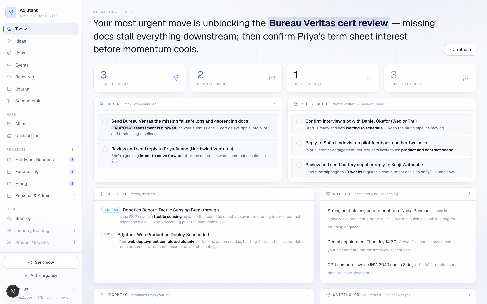
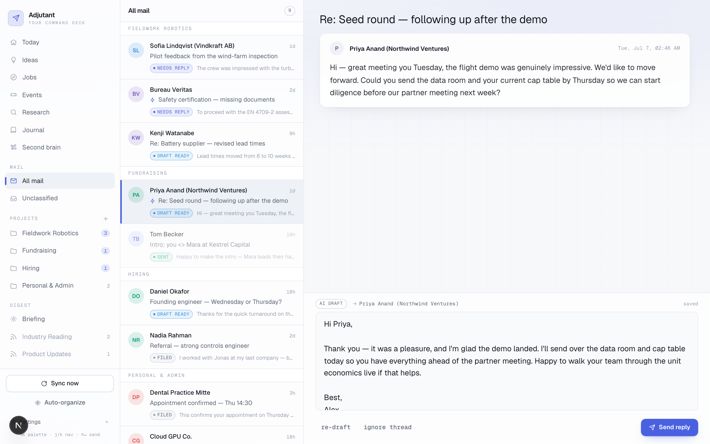
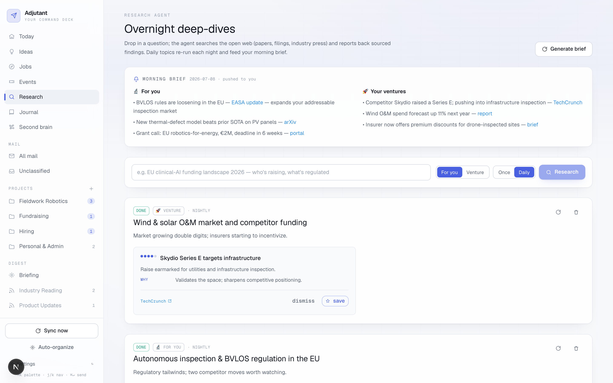
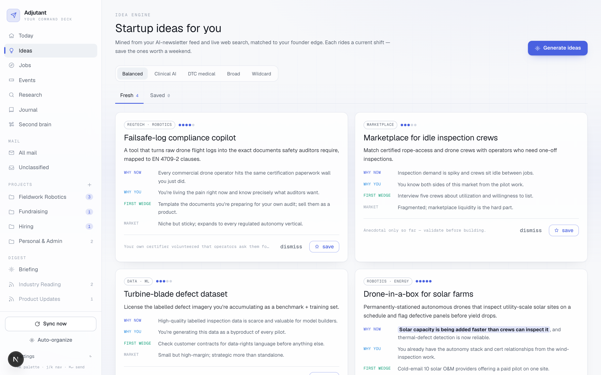

# Adjutant ✈

**A personal AI command deck built around your inbox.** It pulls your Gmail,
sorts every thread into your projects, drafts replies **in your own writing
voice**, and surfaces the day's real work on one screen, then extends the same
idea to research, ideas, jobs, events, a journal, and a searchable second brain.

You review, edit, and send. Nothing ever leaves your account on its own.

<p>
  
  
  
  
</p>

> **Why this exists.** A test of whether the safety-gating patterns I rely on in
> clinical-AI work generalize to a fully agentic email assistant: act only after
> human review, ground every claim, fail closed. Built as a single-user tool and
> shared as a reference implementation, not a hosted product.

## Screenshots

| The command deck: an AI agenda over what needs you | A thread and its AI draft, written in your voice |
| :---: | :---: |
| [](docs/today.png) | [](docs/draft.png) |
| **The research brief**, a two-track morning digest | **Startup ideas**, web-grounded and matched to you |
| [](docs/research.png) | [](docs/ideas.png) |

<sub>All screenshots use the built-in demo data (`python -m scripts.seed_demo`). No real mail or PII.</sub>

## Principles

- **No auto-send, ever.** The only path mail can leave the system is
  `POST /threads/{id}/send`, and it fires solely from the two-step **Send then
  Confirm** click in the dashboard. There is no scheduled or rules-based send
  anywhere in the codebase.
- **Grounded, not hallucinated.** Drafts are written from few-shot examples of
  *your* sent mail and grounded in a profile you control; the drafter reasons
  about the timeline (who replied when, whether an offer's precondition still
  holds) before writing, and never invents dates or facts it wasn't given.
- **Vendor-agnostic, twice.** Every email call lives behind `EmailProvider`
  (`providers/`) and every model call behind `LLMProvider` (`core/llm/`); the
  app only ever sees normalized models. Swapping Gmail for Outlook, or Anthropic
  for OpenAI, is one new file plus one env var, not a refactor.
- **Your data stays yours.** `.env`, `credentials.json`, `token.json`, the
  SQLite database (your actual mail), and your founder profile are all
  git-ignored. Nothing personal is in the repo.
- **You control the spend.** The paid daily jobs (research brief, job scout,
  idea generator) are toggled on and off from Settings, and every LLM call
  routes cheap triage to Haiku and reserves Sonnet for drafting and generation.

## Features

### 📬 Mail: triage & drafting
- **Sync** pulls recent threads, classifies each into a project (or none),
  scores relevance (`reply` / `read` / `skip`) and urgency, and mirrors the
  label back into Gmail.
- **Drafts in your voice.** Few-shot from a corpus of your real sent replies,
  in the thread's language, grounded in your profile. One-click **Re-draft** on
  any thread.
- **Review, edit, send.** A two-step confirm is the only way out; sent replies
  thread correctly (`In-Reply-To`/`References`) and land in Sent.
- **Never loses a reply.** A stale-draft radar and a message-recency scan
  re-open and re-draft any thread the moment a fresh reply lands, even if you
  replied outside the dashboard or the thread has sunk deep in a busy inbox.
- Snooze, mark done, ignore, and a follow-up radar that tracks who you're
  waiting on.

### ⌂ Today: the command deck
An AI agenda over everything that needs you: urgent items (with deadlines
extracted from the email text), a ranked reply queue, FYIs, a deadlines
timeline, and a "waiting on" list. Cached; recomputed only when mail changes.

### 🗂 Organize & digest
Auto-discover categories from unfiled mail and junk the noise; low-priority feed
buckets (newsletters, digests) are demoted to a muted section and summarized by
an on-demand AI briefing, with per-project "standings".

### 📡 Research brief
A two-track morning brief, **For you** (your field/career edge) and **Your
ventures** (market & competitor intel), built from standing topics with live
web search, then pushed to Telegram/email.

### 💡 Ideas · 💼 Jobs · 🎟 Events
Daily, web-grounded and matched to your profile: startup ideas (with focus
modes), roles that fit and stretch you, and real-world events in your city.
Save or dismiss each.

### 📔 Journal & habits · 🧠 Second brain
A daily journal with mood and habit streaks, plus a notes/bookmarks store with
retrieval-based Q&A over everything you've saved.

### ⚙️ Settings
Edit the founder profile that grounds every generation, flip the paid
automations on and off with their monthly cost shown, and switch theme.
Command palette (`⌘K`) and keyboard nav (`j`/`k`/`e`/`⌘↵`) throughout.

## Reliability & safety

The interesting engineering here is in the failure modes of an email agent and
the guardrails around them:

- **A single, audited send path.** `POST /threads/{id}/send` is the only code
  that can send mail, reachable only from the explicit two-step confirm.
  Nothing schedules or rule-triggers a send; drafting and sending are strictly
  separated.
- **Drafts never silently go stale.** A processed thread that gets a fresh
  reply is re-examined, even one you answered outside the dashboard, or one
  that already carries a draft. Three layers cooperate: an idempotency gate
  keyed on the newest message id, a **stale-draft radar** that re-checks the
  whole action queue each sync, and a **message-recency scan** (`messages.list`
  by receive time) that surfaces freshly-replied threads the thread-level
  listing buries beneath the scan window.
- **Ignored is not forgotten.** A thread filed as "skip" is re-opened if a real
  reply later lands on it, so an early triage decision never swallows a
  conversation.
- **Grounded drafting.** The drafter reasons about the timeline before writing:
  it recomputes an earlier message's "next week" against today, and declines an
  offer whose precondition no longer holds. It refuses to state a place, date,
  or commitment not present in the thread or your profile, and that reasoning
  runs in a hidden channel, so it never leaks into the reply.
- **Cost by design.** Triage on Haiku, drafting/generation on Sonnet, and the
  paid daily agents off until you switch them on, each with its monthly cost
  shown in the UI.

## Architecture

```
frontend/  Next.js 16 dashboard   ->  REST  ->   backend/main.py  (FastAPI)

   core/sync.py       pull, classify, label, draft  (idempotent; new-reply radars)
   core/classify.py   Claude: thread -> project | none, relevance, urgency
   core/draft.py      Claude: reply in your voice (few-shot + profile + timeline reasoning)
   core/style.py      style corpus built from your sent mail
   core/agenda.py     the "Today" command deck
   core/digest.py     · standing.py · discover.py   feeds, briefings, auto-organize
   core/research.py   · ideas.py · jobs.py · events.py   web-grounded daily agents
   core/secondbrain.py · notify.py · settings.py
   core/models.py     normalized EmailThread / EmailMessage (provider-agnostic)
   core/llm/          LLMProvider seam: base.py · anthropic.py (default) · openai.py (scaffold)
   db/                SQLAlchemy models + SQL migrations (one row per thread)
   providers/         EmailProvider seam: base.py · gmail.py · outlook.py (scaffold)
```

## Tech stack

| Layer    | Choice |
| -------- | ------ |
| Backend  | Python 3.13 · FastAPI · SQLAlchemy 2 |
| LLM      | Anthropic Claude by default, behind a provider seam: Haiku 4.5 (triage) · Sonnet 4.6 (drafting & generation) · web search. OpenAI backend scaffolded. Few-shot, no fine-tuning |
| DB       | SQLite by default (zero setup) · Postgres/Supabase supported |
| Frontend | Next.js 16 (App Router) · TypeScript · Tailwind v4 |
| Email    | google-api-python-client · OAuth 2.0 desktop flow (Microsoft Graph scaffolded) |

## Quickstart

**Prerequisites:** Python 3.13, Node 20+, an [Anthropic API key](https://console.anthropic.com/),
and a Google Cloud project.

### 1. Google Cloud (~5 min, one-time)
1. [console.cloud.google.com](https://console.cloud.google.com) create a project.
2. **APIs & Services → Library**, enable **Gmail API**.
3. **OAuth consent screen**, choose External, add yourself as a test user.
4. **Credentials → Create credentials → OAuth client ID → Desktop app**.
5. Download the JSON and save it as `backend/credentials.json`.

### 2. Environment
```bash
cp .env.example backend/.env
# fill in ANTHROPIC_API_KEY; everything else has working defaults
```

### 3. Backend
```bash
cd backend
python3 -m venv .venv && .venv/bin/pip install -r requirements.txt
.venv/bin/uvicorn main:app --port 8000
```
Interactive API docs at <http://localhost:8000/docs>.

> Port 8000 taken? Use `--port 8731` and set
> `NEXT_PUBLIC_API_URL=http://localhost:8731` in `frontend/.env.local`
> (and `FRONTEND_ORIGIN` to match your frontend port).

Postgres instead of SQLite: set `DATABASE_URL` in `backend/.env`, then
`psql "$DATABASE_URL" -f backend/db/migrations/001_init.sql` (apply the rest of
`backend/db/migrations/*.sql` in order).

### 4. Style corpus (this is what makes drafts sound like you)
```bash
cd backend
.venv/bin/python -m scripts.build_style_corpus 200
```
Your browser opens for Google consent once (the token is stored in `token.json`
and auto-refreshed). It pulls up to 200 of your sent emails, strips quoted
history, and keeps the usable ones as few-shot style examples. Re-run any time.

### 5. Profile & projects
- Copy `backend/data/founder_profile.example.md` to `founder_profile.md` and make
  it honest; it grounds every generated reply, idea, and job match.
- Add projects via the `+` in the sidebar (or `scripts.seed_projects`). The
  description **is** the classifier's context, so name the people, topics, and
  keywords that define each project.

### 6. Frontend
```bash
cd frontend
npm install
npm run dev        # http://localhost:3000
```

### 7. Fly
Open the dashboard, hit **Sync now**, and threads are pulled, classified,
labeled, and replies drafted. Open a thread, edit the draft (autosaves), then
**Send reply → Confirm**. It goes out from your real account and lands in Sent.

## Cost & automation

The daily agents cost real tokens, and the research brief (multiple web-search
runs on Sonnet) is by far the largest line item. All three are **off unless you
enable them**, toggled from **Settings → Automations & spend** with each job's
rough monthly cost shown next to it. Triage runs on Haiku; drafting and
generation on Sonnet.

## Configuration

Set in `backend/.env` (see `.env.example` for the full list with defaults):

| Variable | Purpose |
| -------- | ------- |
| `ANTHROPIC_API_KEY` | required for classification, drafting, generation |
| `DATABASE_URL` | SQLite (default) or a Postgres URL |
| `CLASSIFY_MODEL` / `DRAFT_MODEL` | swap Claude models per task |
| `SYNC_QUERY` | Gmail search scoping which threads sync |
| `SYNC_MAX_THREADS` / `SYNC_MAX_MESSAGES` | scan-window caps (threads + newest-message recency) |
| `SYNC_INTERVAL_MINUTES` | `0` = manual only; `>0` = background poll |
| `MY_ALIASES` | extra addresses that count as "me" |
| `FRONTEND_ORIGIN` | CORS origin for the dashboard |
| `RESEARCH_DAILY` · `IDEAS_DAILY` · `JOBS_DAILY` | default state of each daily agent (also toggled in the UI) |
| `RESEARCH_BRIEF_HOUR` / `BRIEF_TZ` | when the morning brief fires |
| `NOTIFY_CHANNELS` · `TELEGRAM_BOT_TOKEN` · `TELEGRAM_CHAT_ID` · `NOTIFY_EMAIL` | push destinations |

## API

`POST /sync`, `POST /organize`, and per-thread actions
(`/threads/{id}` · `/draft` · `/redraft` · `/send` · `/snooze` · `/done` ·
`/ignore`) drive the mail loop; `/agenda`, `/digest`, `/standing` build the
deck; `/ideas`, `/jobs`, `/events`, `/research`, `/habits`, `/journal`,
`/notes`, `/brain/ask` power the other panes; `/founder` and
`/settings/automations` hold configuration. **`/threads/{id}/send` is the only
send path.** Full interactive reference at `/docs`.

## Roadmap

- **Outlook.** `providers/outlook.py` implements the same interface against
  Microsoft Graph (device-code flow); it needs an Azure app registration and a
  real-tenant shakeout. Set `EMAIL_PROVIDER=outlook` + `OUTLOOK_CLIENT_ID`.
- **Push instead of poll.** Swap the sync trigger for Gmail Pub/Sub; `run_sync`
  is already a pure function of `(session, provider)`.
- **Calendar / meetings / progress tracking.** The `meetings` and `action_items`
  tables are reserved to FK onto `projects`.

## About

Built by **Carl Luis Pöhl**, working at the intersection of medicine, machine
learning, and clinical AI. This project is a study in carrying the same
human-in-the-loop safety patterns from clinical decision support into an everyday
agent. More projects and background: [github.com/cl-poehl](https://github.com/cl-poehl).

## License

[MIT](LICENSE) © 2026 Carl Luis Pöhl
